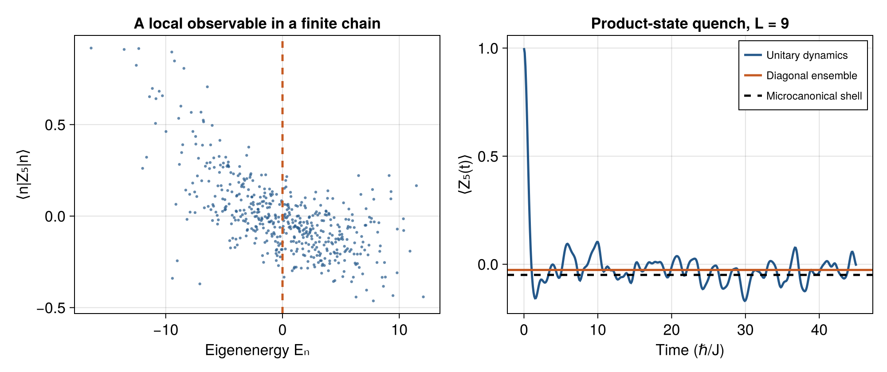

# A reproducible numerical laboratory {#sec-numerical-lab}

This chapter turns the distinctions developed throughout the book into calculations you can inspect and change. It uses Julia for the numerical work and CairoMakie for plotting. The checked-in figures are sufficient to read the chapter; a Julia installation is needed only to regenerate or extend them. All results in this chapter are newly generated examples, rather than reproductions of data in the review.

## Reproduce before extending

From the project directory run:

```bash
julia --project=. -e 'using Pkg; Pkg.instantiate()'
julia --project=. scripts/generate_figures.jl
```

The project specifies Julia 1.12 and records package versions in `Manifest.toml`. The script uses seed `20261019` and sets the BLAS thread count to one. The seed fixes the random samples in this environment; exact floating-point output can still vary slightly across platforms and library versions. Both PNG and vector PDF versions are saved. The HTML book uses PNG and the combined PDF uses the vector sibling.

The [complete Julia script](scripts/generate_figures.jl) is part of the published book, along with the [project dependencies](Project.toml), [manifest](Manifest.toml), and [diagnostics](data/diagnostics.txt). Read the Hamiltonian construction before trusting a plot: a wrong basis convention can produce plausible-looking dynamics.

## Experiment 1: level statistics with a known ensemble

Start with the Gaussian orthogonal ensemble, so the statistical model is specified independently of any many-body conjecture. Draw a real matrix $X$ with independent standard normal entries and set

$$
H=\frac{X+X^{\mathsf T}}{\sqrt{2D}},\qquad D=350.
$$ {#eq-lab-goe}

Its off-diagonal variance is $1/D$ and its diagonal variance is $2/D$. At large $D$ its mean density has the semicircle form

$$
\rho(E)=\frac{D}{2\pi}\sqrt{4-E^2},\qquad |E|<2.
$$

Unfolding transforms energy to mean level count. An antiderivative of the normalized density is

$$
F(E)=\frac12+\frac1\pi\left[\arcsin\frac E2+
\frac E4\sqrt{4-E^2}\right].
$$

Check this by differentiation: the two derivative terms combine to $\sqrt{4-E^2}/(2\pi)$. Define unfolded coordinates $x_n=DF(E_n)$ and spacings $s_n=x_{n+1}-x_n$. The calculation retains eigenvalues 71 through 280 in each of 25 matrices, avoiding the spectral edges, and normalizes the pooled spacings to mean one. This ensemble-density unfolding is appropriate because the ensemble is known. An arbitrary spin chain generally needs its own smooth counting function or an unfolding-free statistic.

The comparison sample consists of independent unit-mean exponential random numbers. That is the exact nearest-neighbor spacing law for a homogeneous Poisson point process. No matrix diagonalization is needed to generate this benchmark. The [spacing data](data/spacings.tsv) include both samples.

The GOE Wigner surmise, $P(s)=(\pi s/2)e^{-\pi s^2/4}$, is exact for a suitably normalized two-level model and an excellent approximation to bulk large-GOE spacings. It is not the exact large-$D$ distribution. The suppression at $s=0$ is the useful qualitative distinction from $e^{-s}$.

**Checkpoint.** Plot the ratio $r_n=\min(s_n,s_{n+1})/\max(s_n,s_{n+1})$. Avoid forming a ratio across the boundary between two independent matrix samples; the checked-in pooled file is intended for the spacing histogram. For a new ratio calculation, keep each spectrum separate.

**Worked answer.** Form `diff(E)` within each retained spectrum, then compute neighboring ratios before pooling. A slowly varying local density approximately cancels. The Poisson mean is $2\ln2-1$, obtained by integrating $r$ against $2/(1+r)^2$ on $[0,1]$. Ratios reduce unfolding sensitivity but still require symmetry resolution in a physical Hamiltonian.

## Experiment 2: exact dynamics of a small spin chain

We use an open chain with $L=9$ spin-$1/2$ sites and $D=512$ states,

$$
H=-\sum_{i=1}^{L-1}Z_iZ_{i+1}
-1.05\sum_{i=1}^L X_i
-\sum_{i=1}^L(0.35+0.07i)Z_i.
$$ {#eq-lab-spin}

Here $X,Z$ are Pauli matrices, not spin operators $\sigma/2$. Energies are in units of the Ising coupling and times in its inverse with $\hbar=1$. The longitudinal field breaks the global spin flip, its spatial variation breaks reflection, and the transverse field mixes magnetization sectors. The model is real, so its remaining antiunitary symmetry is ordinary complex conjugation. These observations make the example useful for studying a generic finite chain; they do not prove chaos or ETH in an infinite system.

A computational state is an integer $s=0,\ldots,2^L-1$. Site 1 is the least significant bit. A zero bit has $Z=+1$, a one bit $Z=-1$, and $X_i$ flips bit $i-1$. Thus the off-diagonal entry is `H[xor(s, 1 << (i-1)) + 1, s+1] = -1.05`. The extra one converts zero-based bit labels to Julia array indices. All $ZZ$ and longitudinal-field terms are diagonal. This construction needs no tensor-library convention.

The observable is $A=Z_5$. Among computational states with $Z_5=+1$, choose the one whose diagonal energy is nearest the mean eigenenergy. This deterministic rule selects a nonstationary product state with energy in the central region. It is a sudden preparation in the final Hamiltonian, equivalently a quench from a strong pinning Hamiltonian whose product ground state is the chosen configuration. The initial energy width remains finite; no narrow-shell limit is presumed.

Diagonalize $H=V\operatorname{diag}(E_n)V^{\dagger}$. If the chosen initial basis index is $j$, then $c_n=V_{jn}^{*}$. In this real model conjugation changes nothing, but it matters for complex Hamiltonians. Compute

$$
\begin{aligned}
A_{nn}&=\sum_s Z_5(s)|V_{sn}|^2,\\
\psi_s(t)&=\sum_n V_{sn}c_ne^{-iE_nt},\\
A(t)&=\sum_s Z_5(s)|\psi_s(t)|^2,\\
A_{\mathrm{DE}}&=\sum_n |c_n|^2A_{nn}.
\end{aligned}
$$ {#eq-lab-dynamics}

The comparison microcanonical value is an unweighted average over $|E_n-E_0|<0.8$, with $E_0=\sum_n|c_n|^2E_n$. Its window is an explicit finite-size choice. A better comparison study varies that width and system size instead of choosing a window after looking at agreement.

{#fig-lab-quench}

The raw [eigenstate table](data/eigenstates.tsv) contains energies, diagonal observable values, and initial probabilities; the [time series](data/quench.tsv) contains the dynamics. The [diagnostic file](data/diagnostics.txt) reports the chosen bit state, shell count, energy width, effective dimension $d_{\mathrm{eff}}=1/\sum_n p_n^2$, and the gap-nondegeneracy expression for the long-time variance. The code does not certify that all energy gaps are nondegenerate; that expression is identified by its assumption.

The script checks Hermiticity, the eigensystem residual, normalization, agreement of the energy computed in both bases, and $A(0)=1$. These checks catch basis, eigenvector, and propagation errors independently of whether the dynamics look thermal.

**Checkpoint.** Why can the diagonal and microcanonical lines differ even when the eigenstate scatter is fairly smooth?

**Worked answer.** The diagonal ensemble weights the full energy distribution $p_n$, while the microcanonical average uses a particular shell. If the smooth curve $a(E)$ bends across the initial distribution, then $\sum_n p_na(E_n)-a(E_0)\simeq a''(E_0)\sigma_E^2/2$. Finite eigenstate fluctuations and finite shell sampling add other errors. A broad distribution or a spectral-edge state need not be represented by a single temperature.

## Experiment 3: classical phase-space structure

The script iterates the standard map

$$
p_{n+1}=p_n+K\sin\theta_n\pmod{2\pi},\qquad
\theta_{n+1}=\theta_n+p_{n+1}\pmod{2\pi}.
$$

Nine initial points are evolved for 1,800 steps at $K=0.2$ and $K=5$. The angle-momentum area is preserved: the kick and free-drift Jacobians each have determinant one. Putting momentum on a torus makes the plot compact; a physical kicked rotor can instead have unbounded momentum on a cylinder. Diffusion on that cylinder cannot be measured from momentum reduced modulo $2\pi$.

Invariant curves, resonant islands, and broad chaotic regions can coexist. Visual coverage of a region by finitely many iterates does not prove ergodicity. To estimate a Lyapunov exponent, evolve a tangent vector with the map Jacobian, periodically renormalize it, and accumulate the logarithms of its growth factors. Compare trajectories started in different visible regions.

**Worked extension.** In the order $(\theta,p)$ the Jacobian is

$$
M_n=\begin{pmatrix}1+K\cos\theta_n&1\\K\cos\theta_n&1\end{pmatrix},
\qquad\det M_n=1.
$$

With $v_{n+1}=M_nv_n$, record $\ell_n=\ln\norm{v_{n+1}}$, rescale to unit norm, and estimate $\lambda=\sum_n\ell_n/n$. Discard a transient and vary both trajectory length and initial conditions. Positive finite-time growth is a numerical diagnostic, not a proof that every trajectory is chaotic.

## Experiment 4: distributions from a continuum model

The heating figure in Chapter 10 illustrates a specified Fokker–Planck model and an equilibrium sharing law. It does not simulate wall collisions. For the first panel choose
$S(E)=\tfrac12\ln E$, $B(E)=E^{3/2}$, and $A(E)=\sqrt E$, satisfying $2A=B\partial_ES+\partial_EB$. In the equivalent Itô equation,

$$
\dd E=\sqrt E\,\dd t+E^{3/4}\dd W_t.
$$

Itô's rule with $x=\sqrt E$ gives

$$
\dd x=\frac38\dd t+\frac12\sqrt x\,\dd W_t.
$$

The entrance-law solution from $x=0$ is a gamma density of shape 3 and scale $t/8$. Transforming back produces

$$
P(E,t)=\frac{\sqrt E}{4(t/8)^3}e^{-8\sqrt E/t},\qquad E>0.
$$

Normalization follows by $E=x^2$, $\dd E=2x\dd x$: the integral becomes the normalized gamma integral. Its mean is $\ev E=3\cdot4(t/8)^2$. The continuum law becomes questionable near energies comparable to the microscopic driving scale; its entrance solution is a mathematical similarity profile that illustrates late-time scaling, rather than a microscopic derivation for a particle initially at rest.

The second panel takes densities of states $\Omega_1(E)\propto E^2$ and $\Omega_2(E)\propto E^2$. At fixed total energy, $u=E_1/E_{\mathrm{tot}}$ has $P(u)=30u^2(1-u)^2$. Integrating the polynomial proves normalization; symmetry gives $\ev u=1/2$. The [sharing table](data/energy-sharing.tsv) permits a direct numerical check. Equal mean energy here follows from choosing identical densities of states. In general equilibrium equalizes inverse temperature.

## A project that tests a claim

Extend the spin-chain calculation to $L=7,8,9,10$ and compare the central part of the spectrum. Specify the window and statistic before examining the result. One useful quantity is the variance of $A_{nn}$ after subtracting a local smooth energy trend. Track the maximum deviation separately from the average deviation: these address different strengths of ETH. Another is the scale of off-diagonal matrix elements inside a narrow mean-energy bin, resolved by frequency.

Dense exact diagonalization uses memory of order $D^2=4^L$ and work of order $D^3$. Doubling a visible chain length is therefore far more expensive than doubling an ordinary array. Keep the first project small, preserve the data, and state the accessible sizes. A careful finite-size conclusion is more informative than an unsupported assertion of universal thermalization.
